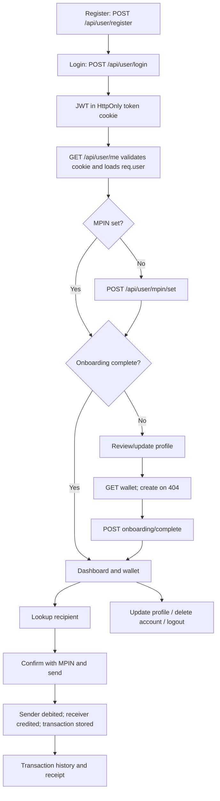

# User Lifecycle and User-Related Functionality

This document describes the implementation present in this repository, not a production banking system. The backend is an Express/Mongoose API mounted by `Src/App.js`; the React frontend is in `../Frontend`.

## 1. Overview

The current implementation supports account registration, password or MPIN login, a JWT cookie session, current-user lookup, limited profile updates, wallet creation and balance lookup, MPIN setup/reset, internal wallet-to-wallet transfers, transaction history, and an on-demand receipt response.

Important boundaries:

- Registration does not create a wallet. The authenticated frontend wallet screen creates one after `GET /api/wallet/getwallet` returns 404.
- “Receiving money” is represented by the receiver wallet being credited by another user's `POST /api/transaction/send`; there is no separate receive or deposit API.
- Account numbers are the user's phone numbers in API responses. The wallet schema itself has no `accountNumber` field.
- The implemented wallet IBAN is a demo string, not a bank-issued or format-validated IBAN.
- Some functionality visible in files is not actually reachable: OTP routes are not mounted by the application and their imports do not match the repository's file paths.

## 2. User Lifecycle Diagram



Steps are dependent on a valid authenticated session after login. MPIN setup is required by the frontend guard before the rest of onboarding. Completion of onboarding requires an existing wallet. Wallet creation and transfers are independent backend routes once authenticated, but the frontend presents them as an ordered journey.

## 3. Project File Map

| Area                       | Files                                                                                                                                                                                                                                                                                                                                                                                                                                                                                                                                                                                                                                                                                                                                                              | Responsibility                                                                 |
| -------------------------- | ------------------------------------------------------------------------------------------------------------------------------------------------------------------------------------------------------------------------------------------------------------------------------------------------------------------------------------------------------------------------------------------------------------------------------------------------------------------------------------------------------------------------------------------------------------------------------------------------------------------------------------------------------------------------------------------------------------------------------------------------------------------ | ------------------------------------------------------------------------------ |
| Express app and database   | [`Src/App.js`](./Src/App.js), [`server.js`](./server.js), [`Src/DB/db.js`](./Src/DB/db.js)                                                                                                                                                                                                                                                                                                                                                                                                                                                                                                                                                                                                                                                                            | Middleware setup, API mount points, startup, MongoDB connection                |
| User/authentication        | [`Src/Models/UserModel.js`](./Src/Models/UserModel.js), [`Src/Controller/UserController.js`](./Src/Controller/UserController.js), [`Src/Routes/UserRoutes.js`](./Src/Routes/UserRoutes.js)                                                                                                                                                                                                                                                                                                                                                                                                                                                                                                                                                                            | User schema, registration, login, profile, MPIN, onboarding, logout, deletion  |
| Authentication and errors  | [`Src/Middleware/IsAuthenticated.js`](./Src/Middleware/IsAuthenticated.js), [`Src/Middleware/AsyncHandler.js`](./Src/Middleware/AsyncHandler.js), [`Src/Middleware/ErrorMiddleware.js`](./Src/Middleware/ErrorMiddleware.js), [`Src/Utils/ErrorHandler.js`](./Src/Utils/ErrorHandler.js)                                                                                                                                                                                                                                                                                                                                                                                                                                                                               | Cookie/JWT validation, forwarding async errors, status mapping                 |
| Wallet                     | [`Src/Models/WalletModel.js`](./Src/Models/WalletModel.js), [`Src/Controller/WalletControl.js`](./Src/Controller/WalletControl.js), [`Src/Routes/WalletRoute.js`](./Src/Routes/WalletRoute.js)                                                                                                                                                                                                                                                                                                                                                                                                                                                                                                                                                                        | Wallet ownership, demo IBAN, wallet and balance endpoints                      |
| Transactions and receipts  | [`Src/Models/TransactionModel.js`](./Src/Models/TransactionModel.js), [`Src/Controller/TransactionController.js`](./Src/Controller/TransactionController.js), [`Src/Routes/TransactionRoute.js`](./Src/Routes/TransactionRoute.js)                                                                                                                                                                                                                                                                                                                                                                                                                                                                                                                                    | Recipient lookup, transfer, history, transaction lookup, receipt               |
| OTP (not mounted)          | [`Src/Models/OtpModel.js`](./Src/Models/OtpModel.js), [`Src/Controller/OtpController.js`](./Src/Controller/OtpController.js), [`Src/Routes/OtpRoute.js`](./Src/Routes/OtpRoute.js), [`Src/Utils/OtpDelivery.js`](./Src/Utils/OtpDelivery.js)                                                                                                                                                                                                                                                                                                                                                                                                                                                                                                                           | OTP logic exists in files but is not wired into `Src/App.js`; see section 16 |
| Frontend API and state     | [`../Frontend/src/Redux/Api/AuthApi.js`](../Frontend/src/Redux/Api/AuthApi.js), [`../Frontend/src/Redux/Api/WalletApi.js`](../Frontend/src/Redux/Api/WalletApi.js), [`../Frontend/src/Redux/Api/Trans.js`](../Frontend/src/Redux/Api/Trans.js), [`../Frontend/src/Redux/Store.js`](../Frontend/src/Redux/Store.js)                                                                                                                                                                                                                                                                                                                                                                                                                                                     | RTK Query endpoint definitions and reducers/middleware                         |
| Frontend lifecycle screens | [`../Frontend/src/App.jsx`](../Frontend/src/App.jsx), [`../Frontend/src/Pages/Auth/Register.jsx`](../Frontend/src/Pages/Auth/Register.jsx), [`../Frontend/src/Pages/Auth/Login.jsx`](../Frontend/src/Pages/Auth/Login.jsx), [`../Frontend/src/Pages/User/UpdatePro.jsx`](../Frontend/src/Pages/User/UpdatePro.jsx), [`../Frontend/src/Pages/User/GetWallet.jsx`](../Frontend/src/Pages/User/GetWallet.jsx), [`../Frontend/src/Pages/Trans/SendTrans.jsx`](../Frontend/src/Pages/Trans/SendTrans.jsx), [`../Frontend/src/Components/Layout/Transactions/ReviewTransfer.jsx`](../Frontend/src/Components/Layout/Transactions/ReviewTransfer.jsx), [`../Frontend/src/Components/Layout/Transactions/Receipt.jsx`](../Frontend/src/Components/Layout/Transactions/Receipt.jsx) | Registration, protected navigation, onboarding, transfer, and receipt UI       |

The backend reads these environment variable **names**. Values are intentionally not shown:

| Variable                                                                   | Use                                                      |
| -------------------------------------------------------------------------- | -------------------------------------------------------- |
| `PORT`                                                                   | Express listen port                                      |
| `DB_URI`                                                                 | MongoDB connection string                                |
| `JWT_SECRET`                                                             | JWT signing and verification                             |
| `NODE_ENV`                                                               | Cookie `secure` setting and error response detail mode |
| `OTP_SECRET`, `OTP_EXPIRY_MINUTES`                                     | OTP hashing key and configured expiry                    |
| `SMTP_HOST`, `SMTP_PORT`, `SMTP_USER`, `SMTP_PASS`, `EMAIL_FROM` | Email OTP delivery                                       |
| `SENDPK_API_KEY`, `SENDPK_SENDER`, `SENDPK_TEMPLATE_ID`              | SMS OTP delivery                                         |

`OTP_EXPIRY_MINUTES` defaults to 5 in code. The frontend dev server proxies `/api` to `http://localhost:4000` in [`../Frontend/vite.config.js`](../Frontend/vite.config.js). Do not put secret values in this document or client-side code.

For Vercel, configure `DB_URI` and `JWT_SECRET` in the backend project's Environment Variables for each deployment environment; a local `Backend/.env` file is ignored by Git and is not deployed. `DB_URI` must point to the intended Atlas cluster/database, and Atlas must allow network access from the deployment. The API waits for MongoDB before handling requests and returns a generic 503 if the connection is unavailable; server logs classify connection failures without logging the URI or credentials. The frontend calls the relative `/api/...` path, so production hosting must route that path to this backend on the same site. If frontend and backend use separate origins, verify the deployment's API routing, CORS, and cookie configuration manually.

## 4. User Model and Schema

[`Src/Models/UserModel.js`](./Src/Models/UserModel.js) defines the `User` collection. Fields and behavior:

| Field                        | Type / default             | Meaning                                                              |
| ---------------------------- | -------------------------- | -------------------------------------------------------------------- |
| `_id`                      | MongoDB ObjectId           | Database identity                                                    |
| `fullName`                 | String                     | Display name; schema has a minimum-length setting                    |
| `email`                    | String, unique             | Login/contact email; model regex validation                          |
| `password`                 | String                     | Stored as bcrypt hash by a `pre("save")` hook using 10 salt rounds |
| `phone`                    | String, unique             | Login/contact number; model pattern is `03` plus 9 digits          |
| `phoneVerifiction`         | Boolean, default `false` | Existing misspelled field; no active controller updates it           |
| `avatar`                   | String, default `""`     | Avatar value                                                         |
| `onboardingCompleted`      | Boolean, default `false` | Frontend onboarding flag                                             |
| `homeTourCompleted`        | Boolean, default `false` | Frontend home-tour flag                                              |
| `mpinHash`                 | String,`select: false`   | Bcrypt hash used for MPIN; not selected by default                   |
| `mpinSet`                  | Boolean, default `false` | Indicates whether MPIN login/transfer confirmation is enabled        |
| `createdAt`, `updatedAt` | Timestamps                 | Mongoose-managed timestamps                                          |

`comparePassword` is defined as a model method, though login currently calls `bcrypt.compare` directly. `toJSON` removes `password`; `mpinHash` is excluded by default query selection. `generateAuthToken` signs a different payload (`_id`) and expiry (7 days) from the active controller flow; it is not called by the routes.

The schema uses `require: true` rather than Mongoose's `required: true` for `fullName`, `email`, `password`, and `phone`. Consequently, the intended required-field validation is not reliably enforced by the schema. Unique fields have unique indexes, but uniqueness depends on those indexes existing in the connected database.

## 5. Authentication Architecture

### JWT and cookie flow

The active login and MPIN-reset controllers sign `{ id: user._id }` with `JWT_SECRET` and `expiresIn: "1h"`. `loginUser` and `resetMpin` set a cookie named `token` with:

- `httpOnly: true` (not readable by browser JavaScript)
- `secure: true` only when `NODE_ENV === "production"`
- `sameSite: "lax"`
- one-hour `maxAge`

The user registration controller also signs a one-hour token, but returns it in the JSON response and does **not** set the cookie. The frontend registration form ignores that token and navigates to login.

`isAuthenticated` in [`Src/Middleware/IsAuthenticated.js`](./Src/Middleware/IsAuthenticated.js):

1. Reads `req.cookies.token` (not an `Authorization: Bearer` header).
2. Returns 401 if it is absent.
3. Calls `jwt.verify(token, process.env.JWT_SECRET)`.
4. Loads the database user using `decoded.id`.
5. Returns 404 if that user no longer exists.
6. Assigns the Mongoose user document to `req.user` and calls `next()`.

The global error middleware maps JWT verification errors and expired tokens to 401. Since the middleware logs decoded claims and the loaded user object to the server console, those diagnostics may expose user identifiers/contact data in logs.

### Identity in a protected controller

```js
// isAuthenticated has verified the cookie and fetched this user.
const senderId = req.user._id;
const senderWallet = await Wallet.findOne({ user: senderId });
```

`req.user` is populated by trusted server-side authentication middleware. Controllers should normally use `req.user._id` for the current account instead of trusting an ID supplied by the client: a request parameter/body ID is user-controlled and can otherwise let one authenticated user target another account. The current `updateUser` and `getUserById` controllers accept `req.params.userId` without checking it against `req.user._id`; this is an authorization gap.

### Request locations

| Source         | Example                                    | Use                                                          |
| -------------- | ------------------------------------------ | ------------------------------------------------------------ |
| `req.params` | `/api/user/me/65...` -> `userId`       | Path identifier; currently used for profile read/update      |
| `req.query`  | `/api/transaction/transactions?limit=20` | URL query options; no current route reads query parameters   |
| `req.body`   | JSON `{ "amount": 500 }`                 | POST/PATCH/DELETE payload; parsed by Express JSON middleware |

### Protected route and sequence diagrams

```mermaid
sequenceDiagram
    participant UI as Frontend
    participant API as Express API
    participant Auth as isAuthenticated
    participant DB as MongoDB
    UI->>API: POST /api/user/login (phone + password or MPIN)
    API->>DB: Find User; compare stored bcrypt hash
    DB-->>API: User document
    API-->>UI: 200 + Set-Cookie: token (HttpOnly)
    UI->>API: GET /api/user/me (credentials: include)
    API->>Auth: Request with token cookie
    Auth->>Auth: jwt.verify(token, JWT_SECRET)
    Auth->>DB: User.findById(decoded.id)
    DB-->>Auth: User document or not found
    Auth->>API: Attach req.user; next()
    API-->>UI: 200 { success, user }
```

## 6. User Routes Reference

The complete route prefixes are `/api/user`, `/api/wallet`, and `/api/transaction`, mounted in `Src/App.js`. Every route below has no query-parameter behavior. Body examples are JSON; send `Content-Type: application/json` when a body is present. Browser API clients send the cookie using `credentials: "include"`.

### User and authentication routes

| Name / purpose            | Method and endpoint                              | Auth | Middleware order                                         | Controller             |
| ------------------------- | ------------------------------------------------ | ---- | -------------------------------------------------------- | ---------------------- |
| Register account          | `POST /api/user/register`                      | No   | `createUser` async wrapper                             | `createUser`         |
| Login                     | `POST /api/user/login`                         | No   | `loginLimiter` (10 requests / 15 min) -> `loginUser` | `loginUser`          |
| Reset MPIN using password | `POST /api/user/mpin/reset`                    | No   | `resetMpinLimiter` (5 / 15 min) -> `resetMpin`       | `resetMpin`          |
| Get current user          | `GET /api/user/me`                             | Yes  | `isAuthenticated` -> `getMe`                         | `getMe`              |
| Set MPIN                  | `POST /api/user/mpin/set`                      | Yes  | `isAuthenticated` -> `setMpin`                       | `setMpin`            |
| Complete onboarding       | `POST /api/user/onboarding/complete`           | Yes  | `isAuthenticated` -> `completeOnboarding`            | `completeOnboarding` |
| Complete home tour        | `POST /api/user/onboarding/home-tour/complete` | Yes  | `isAuthenticated` -> `completeHomeTour`              | `completeHomeTour`   |
| List user directory       | `GET /api/user/users`                          | Yes  | `isAuthenticated` -> `getAllUsers`                   | `getAllUsers`        |
| Read user by ID           | `GET /api/user/me/:userId`                     | Yes  | `isAuthenticated` -> `getUserById`                   | `getUserById`        |
| Update user by ID         | `PATCH /api/user/me/:userId`                   | Yes  | `isAuthenticated` -> `updateUser`                    | `updateUser`         |
| Logout                    | `POST /api/user/logout`                        | Yes  | `isAuthenticated` -> `logoutUser`                    | `logoutUser`         |
| Delete current user       | `DELETE /api/user/delete`                      | Yes  | `isAuthenticated` -> `deleteUser`                    | `deleteUser`         |

Requests and successful responses:

| Route               | Request parameters/body example                                                                                      | Success response                                                                                                                                                                                                                                                    |
| ------------------- | -------------------------------------------------------------------------------------------------------------------- | ------------------------------------------------------------------------------------------------------------------------------------------------------------------------------------------------------------------------------------------------------------------- |
| Register            | `{ "fullName":"Ayesha Khan", "email":"ayesha@example.com", "phone":"03001234567", "password":"example-pass-123" }` | 201:`{ "message":"User created successfully", "token":"<omitted>", "user": { "id":"<ObjectId>", "fullName":"Ayesha Khan", "email":"ayesha@example.com", "phone":"03001234567", "onboardingCompleted":false } }`. Token is returned in JSON, not a cookie.         |
| Login               | `{ "phone":"03001234567", "mpin":"1234" }` or `{ "email":"ayesha@example.com", "password":"example-pass-123" }`  | 200:`{ "success":true, "message":"Login successful", "user":{ "id":"<ObjectId>", "fullName":"Ayesha Khan", "email":"ayesha@example.com", "phone":"03001234567", "onboardingCompleted":false, "mpinSet":true }, "requiresMpinSetup":false }`, plus `Set-Cookie`. |
| Reset MPIN          | `{ "phone":"03001234567", "password":"example-pass-123", "mpin":"1234", "confirmMpin":"1234" }`                    | 200:`{ "success":true, "message":"MPIN reset successfully.", "user":{ "id":"<ObjectId>", "fullName":"Ayesha Khan", "email":"ayesha@example.com", "phone":"03001234567", "onboardingCompleted":false, "mpinSet":true } }`, plus `Set-Cookie`.                    |
| Current user        | Cookie `token=<JWT>`                                                                                               | 200:`{ "success":true, "user":{ "_id":"<ObjectId>", "fullName":"Ayesha Khan", "email":"ayesha@example.com", "phone":"03001234567", "mpinSet":true, ... } }`. Password is removed by `toJSON`; MPIN hash is not selected.                                        |
| Set MPIN            | `{ "mpin":"1234", "confirmMpin":"1234" }`                                                                          | 200:`{ "success":true, "message":"MPIN set successfully.", "user":{ ... } }`.                                                                                                                                                                                     |
| Complete onboarding | No body required                                                                                                     | 200:`{ "success":true, "message":"Onboarding completed", "user":{ ... } }`; requires a wallet first.                                                                                                                                                              |
| Complete home tour  | No body required                                                                                                     | 200:`{ "success":true, "message":"Home tour completed", "user":{ ... } }`.                                                                                                                                                                                        |
| List users          | No body                                                                                                              | 200:`{ "success":true, "count":1, "users":[{ "_id":"<ObjectId>", "fullName":"Ayesha Khan", "phone":"03001234567" }] }`.                                                                                                                                           |
| Read user by ID     | `:userId` path example `65f012345678901234567890`                                                                | 200:`{ "success":true, "user":{ ... } }`; returns the selected document's default fields after `toJSON`, but does not restrict the ID to the caller.                                                                                                            |
| Update user         | `:userId` plus `{ "fullName":"Ayesha Khan", "email":"ayesha@example.com", "phone":"03001234567" }`               | 200:`{ "success":true, "message":"User updated successfully", "user":{ ... } }`. Accepted body fields are only `fullName`, `email`, and `phone`.                                                                                                            |
| Logout              | Cookie `token=<JWT>`                                                                                               | 200:`{ "success":true, "message":"Logout successfully" }`; clears the cookie on the response.                                                                                                                                                                     |
| Delete user         | `{ "password":"example-pass-123" }`                                                                                | 200:`{ "success":true, "message":"User deleted successfully" }`; deletes the owned wallet and user, then clears the cookie.                                                                                                                                       |

#### User-route execution details

- **`POST /api/user/register` — `createUser`:** 1. Express parses JSON. 2. Controller reads `fullName`, `email`, `password`, and `phone`; checks whether email or phone already exists. 3. It creates and saves a `User`; the model save hook hashes the password. 4. Controller signs a JWT and returns the created user fields and token in JSON.
- **`POST /api/user/login` — `loginUser`:** 1. `loginLimiter` runs before the controller. 2. Controller chooses email lookup when email is provided, otherwise normalizes phone digits. 3. It selects credential hashes and compares the provided password or MPIN according to `mpinSet`. 4. On success it signs a JWT, sets the cookie, and returns selected user fields; credential failures clear the cookie and forward an error.
- **`POST /api/user/mpin/reset` — `resetMpin`:** 1. `resetMpinLimiter` runs. 2. Controller requires phone/password and validates matching four-digit MPIN inputs. 3. It normalizes phone, loads the user with password hash, and compares password. 4. It hashes/saves MPIN, signs a one-hour JWT, sets the cookie, and responds with user fields.
- **`GET /api/user/me` — `getMe`:** 1. Authentication middleware validates the token and loads the user. 2. Controller returns `req.user`; user serialization omits password.
- **`POST /api/user/mpin/set` — `setMpin`:** 1. Authentication middleware supplies `req.user`. 2. Controller validates four digits and confirmation. 3. It rejects an already-set MPIN, bcrypt-hashes the new MPIN, updates the authenticated user's hash/flag, and returns the user.
- **`POST /api/user/onboarding/complete` — `completeOnboarding`:** 1. Authentication middleware supplies current identity. 2. Controller checks `Wallet.findOne({ user: req.user._id })`; absent wallet returns 400. 3. It sets `onboardingCompleted` true and returns the updated user.
- **`POST /api/user/onboarding/home-tour/complete` — `completeHomeTour`:** 1. Authentication middleware supplies current identity. 2. Controller updates `homeTourCompleted` to true for that user and returns the updated user.
- **`GET /api/user/users` — `getAllUsers`:** 1. Authentication middleware validates the caller. 2. Controller queries all users, selects `fullName` and `phone`, sorts by name, and returns count/list.
- **`GET /api/user/me/:userId` — `getUserById`:** 1. Authentication middleware validates the caller. 2. Controller reads `userId` from `req.params` and calls `User.findById`. 3. It returns 404 if absent or the user document otherwise. It does not check ownership.
- **`PATCH /api/user/me/:userId` — `updateUser`:** 1. Authentication middleware validates the caller. 2. Controller copies only supplied `fullName`, `email`, and `phone` into an update object (email is trimmed/lowercased). 3. It applies `$set` to the path `userId` with `runValidators: true`; missing user returns 404, otherwise it returns the updated document. It does not check ownership.
- **`POST /api/user/logout` — `logoutUser`:** 1. Authentication middleware must succeed first. 2. Controller clears the `token` cookie and returns 200. There is no server-side token revocation record.
- **`DELETE /api/user/delete` — `deleteUser`:** 1. Authentication middleware supplies current identity. 2. Controller requires a password, loads current user with password selected, and compares bcrypt hash. 3. It deletes the user's wallet and then the user, clears the cookie, and returns 200.

### Wallet routes

| Name / purpose     | Method and endpoint               | Auth | Middleware order                        | Controller       |
| ------------------ | --------------------------------- | ---- | --------------------------------------- | ---------------- |
| Get wallet         | `GET /api/wallet/getwallet`     | Yes  | `isAuthenticated` -> `getWallet`    | `getWallet`    |
| Create wallet      | `POST /api/wallet/createwallet` | Yes  | `isAuthenticated` -> `createWallet` | `createWallet` |
| Get balance/status | `GET /api/wallet/balance`       | Yes  | `isAuthenticated` -> `getBalance`   | `getBalance`   |

No request body, params, or query values are used by these wallet endpoints. A successful `getWallet`/`createWallet` response is `{ "success":true, "message":"Wallet fetched successfully", "wallet":{ "accountNumber":"03001234567", "iban":"PK...", "balance":10000 } }` (the create message is `"Wallet created successfully"`). `getBalance` returns `{ "success":true, "wallet":{ "balance":10000, "status":"ACTIVE", "iban":"PK..." } }`. The initial balance comes from the wallet model default; this is demo behavior, not a deposit.

#### Wallet-route execution details

- **`GET /api/wallet/getwallet` — `getWallet`:** 1. Authentication middleware supplies `req.user`. 2. Controller looks up a wallet with `user: req.user._id`. 3. Missing wallet returns 404; otherwise the controller returns phone as `accountNumber` plus wallet IBAN and balance.
- **`POST /api/wallet/createwallet` — `createWallet`:** 1. Authentication middleware supplies `req.user`. 2. Controller checks for a wallet already owned by that user and forwards 409 if found. 3. It generates the demo IBAN, creates the wallet with the schema's default balance/status, and returns the wallet summary.
- **`GET /api/wallet/balance` — `getBalance`:** 1. Authentication middleware supplies current identity (the controller also checks that it exists). 2. Controller finds the user's wallet. 3. Missing wallet returns 404; otherwise balance, status, and IBAN are returned.

### Transaction and receipt routes

| Name / purpose                   | Method and endpoint                                 | Auth | Middleware order                                               | Controller             |
| -------------------------------- | --------------------------------------------------- | ---- | -------------------------------------------------------------- | ---------------------- |
| Lookup recipient                 | `POST /api/transaction/recipient/lookup`          | Yes  | `isAuthenticated` -> async handler -> `lookupRecipient`    | `lookupRecipient`    |
| Send money                       | `POST /api/transaction/send`                      | Yes  | `isAuthenticated` -> async handler -> `sendMoney`          | `sendMoney`          |
| List current user's transactions | `GET /api/transaction/transactions`               | Yes  | `isAuthenticated` -> async handler -> `getTransactions`    | `getTransactions`    |
| Get one accessible transaction   | `GET /api/transaction/transaction/:transactionId` | Yes  | `isAuthenticated` -> async handler -> `getTransactionById` | `getTransactionById` |
| Get receipt                      | `GET /api/transaction/receipt/:transactionId`     | Yes  | `isAuthenticated` -> async handler -> `getReceipt`         | `getReceipt`         |

Requests and successful responses:

| Route             | Request parameters/body example                                                             | Success response                                                                                                                                                                                                                                                                                                     |
| ----------------- | ------------------------------------------------------------------------------------------- | -------------------------------------------------------------------------------------------------------------------------------------------------------------------------------------------------------------------------------------------------------------------------------------------------------------------- |
| Lookup recipient  | `{ "receiverAccount":"03007654321" }` or `{ "receiverAccount":"PK..." }`                | 200:`{ "success":true, "recipient":{ "fullName":"Bilal Ahmed", "accountNumber":"PK..." } }`. The returned `accountNumber` is the recipient wallet IBAN.                                                                                                                                                          |
| Send money        | `{ "receiverAccount":"03007654321", "amount":500, "description":"Lunch", "mpin":"1234" }` | 201:`{ "success":true, "message":"Money sent successfully", "transaction":{ "_id":"<ObjectId>", "transactionId":"TXN-...", "sender":"<ObjectId>", "receiver":"<ObjectId>", "amount":500, "type":"SEND", "status":"SUCCESS", "description":"Lunch", ... } }`.                                                       |
| List transactions | No body                                                                                     | 200:`{ "success":true, "count":1, "transactions":[...] }`; includes rows where current user is sender or receiver, newest first, with sender/receiver `fullName` and `phone` populated.                                                                                                                        |
| Get transaction   | `:transactionId` can be MongoDB `_id` or custom `transactionId` (e.g. `TXN-...`)    | 200:`{ "success":true, "transaction":{...} }`; only a transaction involving the authenticated user is returned.                                                                                                                                                                                                    |
| Receipt           | Same identifier choices as transaction lookup                                               | 200:`{ "success":true, "receipt":{ "receiptId":"RCP-TXN-...", "transactionId":"TXN-...", "sender":{"name":"Ayesha Khan","phone":"03001234567"}, "receiver":{"name":"Bilal Ahmed","phone":"03007654321"}, "amount":500, "currency":"PKR", "description":"Lunch", "status":"SUCCESS", "date":"<ISO timestamp>" } }`. |

#### Transaction-route execution details

- **`POST /api/transaction/recipient/lookup` — `lookupRecipient`:** 1. Authentication middleware runs. 2. Controller requires `receiverAccount`. 3. `resolveReceiver` tries normalized IBAN then Pakistani phone, resolves the wallet and recipient name. 4. It rejects unknown, self, or inactive recipient wallets; otherwise returns recipient name and wallet IBAN.
- **`POST /api/transaction/send` — `sendMoney`:** 1. Authentication middleware runs. 2. Controller validates identity, receiver, amount (finite and at least 100), and MPIN format/hash. 3. It resolves receiver and rejects self-transfer. 4. Inside a MongoDB session transaction, it reloads both wallets, checks statuses and balance, conditionally debits the sender, credits the receiver, and inserts the transaction. 5. It returns success only after the transaction commits.
- **`GET /api/transaction/transactions` — `getTransactions`:** 1. Authentication middleware runs. 2. Controller queries transactions where the current user's ID is sender or receiver. 3. It populates sender/receiver name and phone, sorts newest first, then returns count and list.
- **`GET /api/transaction/transaction/:transactionId` — `getTransactionById`:** 1. Authentication middleware runs. 2. Controller reads the path identifier. 3. Shared finder selects Mongo `_id` when the value is a valid ObjectId, otherwise custom `transactionId`, and scopes the query to sender/receiver. 4. It returns 404 when no accessible match exists or returns the populated transaction.
- **`GET /api/transaction/receipt/:transactionId` — `getReceipt`:** 1. Authentication middleware runs. 2. Controller reads the identifier and uses the same accessible transaction finder. 3. It builds a receipt object from the populated transaction in memory and returns JSON; no database write or file generation occurs.

All body-bearing requests should use `Content-Type: application/json`; no route accepts a meaningful query parameter. An authenticated command-line request must send the `token` cookie, for example:

```sh
curl -i -X GET http://localhost:4000/api/user/me \
  -H 'Cookie: token=<JWT>'
```

## 7. User Registration Flow

1. The frontend [`Register`](../Frontend/src/Pages/Auth/Register.jsx) validates a non-empty name, local Pakistani phone format, email format, and password length of at least 8 characters.
2. `useRegisterMutation` posts JSON to `/api/user/register` with `credentials: "include"`.
3. `UserRoutes.js` sends the request to `createUser` without authentication or a route rate limiter.
4. `createUser` checks for an existing email or phone, constructs `User`, and saves it. The model's save hook bcrypt-hashes the password.
5. The controller signs a one-hour JWT and returns it in the response body alongside a safe-shaped user object. It does not set `token` cookie.
6. The frontend shows a success toast and navigates to `/login`; it does not retain or use the registration token.

Registration does not create a wallet or mark the account verified. The active registration response does not include an `success` property, unlike most other successful responses.

## 8. Login and Session Flow

`Login.jsx` uses the phone number and either MPIN or password. It posts to `/api/user/login` through `useLoginMutation`. The server chooses email when supplied; otherwise it normalizes phone digits. The user lookup explicitly selects password and MPIN hashes, then bcrypt compares the credential. If `mpinSet` is true, login uses MPIN; otherwise it uses password. Login emits the HTTP-only cookie and returns only display/session flags to the frontend.

The frontend routes a newly logged-in user to `/set-mpin` if `mpinSet` is false, then to profile/wallet onboarding if `onboardingCompleted` is false. Otherwise, it navigates to the route the protected user originally requested, or `/`.

`POST /api/user/mpin/reset` is a separate, unauthenticated phone-plus-password recovery flow. On success, it hashes the new MPIN and creates a one-hour cookie. Both login and reset have IP/request limiter middleware in the route file.

The authentication process is visualized in the sequence diagram in section 5. The key is that a cookie is only a carrier: the server verifies its JWT on each protected API call and reloads the user before controller code runs.

## 9. Current User and Profile Flow

`GET /api/user/me` is the current-user endpoint (`getMe`). It has no body or URL identifier. `isAuthenticated` sets `req.user`; `getMe` returns it. The frontend `ProtectedRoute` in `App.jsx` calls the `getMe` RTK Query hook and decides whether to render protected pages, redirect to login, or require MPIN/onboarding.

Profile editing currently works as follows:

1. `UpdatePro.jsx` directly fetches `/api/user/me` with `credentials: "include"` and reads `user._id`.
2. It sends `PATCH /api/user/me/:userId` using `useUpdateUserMutation`.
3. `updateUser` allows only `fullName`, `email`, and `phone` fields and uses `$set` with Mongoose validators enabled.
4. The route authenticates the caller, but the controller updates the user ID from the URL without confirming it equals `req.user._id`.

Account deletion is implemented at `DELETE /api/user/delete`. The UI asks for a password and confirmation; the controller requires and bcrypt-checks the password, deletes the user's wallet and user record, and clears the cookie. It does not delete or preserve/settle related transactions explicitly, and those deletes are not one database transaction.

## 10. Wallet Relationship and Flow

[`WalletModel.js`](./Src/Models/WalletModel.js) stores `user` as a required, unique ObjectId reference to `User`. Thus the model permits at most one wallet per user at the database-index level. The controller also queries for an existing wallet before insert and returns 409 if found.

| Wallet field | Meaning                                                                 |
| ------------ | ----------------------------------------------------------------------- |
| `user`     | Owner `User` ObjectId reference                                       |
| `iban`     | Unique string; controller generates `PK${Date.now()}${random 0..999}` |
| `balance`  | Number, default 10000, minimum 0                                        |
| `status`   | `ACTIVE`, `INACTIVE`, or `BLOCKED`; defaults to `ACTIVE`        |
| timestamps   | Mongoose timestamps                                                     |

There is no wallet schema `accountNumber` property. `WalletControl.js` places `req.user.phone` into the response under `accountNumber`; this is also the value `resolveReceiver` uses to find a recipient's User and then wallet. Current user's wallet lookup is `Wallet.findOne({ user: req.user._id })`. The ownership check for the current wallet is therefore based on the server-authenticated ID, not a client-provided wallet ID.

On the frontend, `GetWallet.jsx` first queries `GET /getwallet`; when it receives a 404, it attempts `POST /createwallet`, then refetches. During onboarding, it calls `POST /api/user/onboarding/complete` only after wallet data has loaded. `getBalance` is used separately by the dashboard balance widget.

Identifier distinctions:

- MongoDB `_id`: internal ObjectId for a database document/user/wallet/transaction.
- `accountNumber`: API presentation name for the user's phone number; not a wallet field.
- `iban`: wallet field generated by the demo controller; no IBAN format validation or guaranteed global banking semantics.
- `transactionId`: separately indexed custom string (`TXN-...`) for a transaction.
- `receiptId`: derived on demand as `RCP-` plus the transaction's custom ID (or Mongo ID fallback); not stored separately.

The unique wallet and IBAN constraints are enforced by MongoDB unique indexes when present. The pre-check alone cannot prevent concurrent creates. The generated IBAN can theoretically collide; a database duplicate-key error is mapped to 409.

## 11. Transaction Flow

### Send money and receive money

The sender provides a receiver phone/IBAN, amount, optional description, and MPIN. `resolveReceiver` normalizes the identifier, looks up an IBAN first, otherwise looks up a matching phone and then the wallet. The controller verifies the sender MPIN, rejects self-transfer, then starts a MongoDB session transaction. Within it, the controller reloads the sender and receiver wallets, checks both are active and the sender has sufficient funds, conditionally decrements the sender balance, increments the receiver balance, and creates the `Transaction` record.

The `Transaction` schema has `transactionId`, `sender` and `receiver` references to `User`, `amount` (minimum 100), `type` (`SEND` or `RECEIVER`), `status` (`SUCCESS` or `FAILED`), `description`, and timestamps. The current send path stores one `SEND` record for both parties; it does not create a separate receiver transaction record. The receiver sees the same transaction because history queries `$or: [{sender:userId}, {receiver:userId}]`.

The frontend sequence is:

1. [`SendTrans.jsx`](../Frontend/src/Pages/Trans/SendTrans.jsx) validates the minimum amount and calls recipient lookup.
2. It navigates to `ReviewTransfer.jsx` with the recipient and draft data in router state.
3. The user checks the recipient/amount, confirms, and enters MPIN.
4. `ReviewTransfer.jsx` calls send; when a `transactionId` is returned it navigates to `/receipt/:transactionId`.
5. History loads separately using `GET /api/transaction/transactions`.

### Consistency and atomicity

The transfer now uses `session.withTransaction(...)` to include both wallet balance changes and the transaction insert in one MongoDB transaction. The sender debit uses a conditional update requiring `balance >= amount`; if it does not match, the controller aborts with an insufficient-balance error. A failure in the credit or transaction insert aborts the corresponding debit as well. This protects the multi-document transfer from partial commits and concurrent overspending, subject to MongoDB transaction support. Multi-document transactions require a replica-set or sharded MongoDB deployment; a standalone server cannot execute this flow successfully. There is still no idempotency key to distinguish an intentional retry after an ambiguous network failure.

### Important request traces

#### A. Register and login

1. Frontend submits registration JSON to `POST /api/user/register`.
2. Express routes the request to `createUser`; there is no authentication middleware on registration.
3. Controller checks duplicate email/phone, builds the `User`, and saves it.
4. User model hashes the password before save.
5. Controller returns 201, a one-hour JWT in JSON, and selected user fields. The UI ignores this token and navigates to login.
6. Login posts to `POST /api/user/login`; the route applies `loginLimiter`.
7. Controller selects the credential hash and compares it, signs `{id}`, sets the `token` cookie, and returns safe user/session fields.

#### B. Load current user

1. Frontend RTK Query sends `GET /api/user/me` with credentials included.
2. Router applies `isAuthenticated`.
3. Middleware reads and verifies the cookie, then fetches the user using the decoded `id`.
4. It assigns that user to `req.user`.
5. `getMe` returns `{ success: true, user: req.user }`.
6. `ProtectedRoute` uses the response to allow/redirect the page and enforce MPIN/onboarding navigation.

#### C. Create or retrieve wallet

1. Authenticated frontend calls `GET /api/wallet/getwallet`.
2. `isAuthenticated` resolves `req.user`.
3. `getWallet` queries the wallet by `{ user: req.user._id }`.
4. A missing wallet returns 404; the UI then calls `POST /api/wallet/createwallet`.
5. `createWallet` checks for an existing wallet, generates the demo IBAN, creates the wallet, and returns account number, IBAN, and balance.
6. The UI refetches the wallet. A concurrent create can still race; unique-index conflict is handled as 409.

#### D. Send money

1. Authenticated frontend posts receiver, amount, description, and MPIN to `/api/transaction/send`.
2. Middleware attaches the current user; `sendMoney` validates required values, numeric minimum, and four-digit MPIN.
3. It loads the current user with `mpinHash`, compares the hash, resolves the receiver, rejects self-transfer, finds the sender wallet, and checks both wallet statuses and available balance.
4. It starts a session transaction, reloads both wallets inside it, and verifies statuses and current sender balance.
5. It conditionally decrements sender balance (`balance >= amount`), increments the active receiver wallet, and saves the new `Transaction` document using the same session.
6. It returns 201 only after the database transaction commits. If any operation fails, the transaction aborts. MongoDB must support multi-document transactions for this endpoint to work.

#### E. Retrieve transaction and receipt

1. The user calls `/api/transaction/transaction/:transactionId` or `/api/transaction/receipt/:transactionId` with the cookie.
2. Authentication middleware supplies `req.user._id`.
3. Controller treats a valid MongoDB ObjectId as `_id`; any other identifier is queried as `transactionId`.
4. `findAccessibleTransaction` adds a sender-or-receiver condition and populates only sender/receiver names and phone numbers.
5. A nonmatching/missing transaction returns 404; there is no distinction between nonexistent and another user's transaction.
6. For a receipt, the controller constructs a plain JSON object at request time. The frontend can print it or use the browser's Save as PDF action. No receipt file/document is generated or persisted on the server.

## 12. Receipt Flow

The route is `GET /api/transaction/receipt/:transactionId`; the path accepts either MongoDB `_id` or custom `transactionId`. `getReceipt` uses the same access-scoped transaction finder as transaction lookup, so only the sender or receiver can read the receipt. It returns a receipt identifier, transaction identifier, sender/receiver name and phone, amount, fixed currency `PKR`, description, status, and creation date.

The React `Receipt` component gets its `transactionId` from `/receipt/:transactionId`, invokes `useGetReceiptQuery`, renders loading/error/success states, and offers browser print / Save as PDF. The receipt is an API representation, not a signed or stored financial document.

## 13. Frontend and RTK Query Integration

All three API slices use relative same-origin paths and `credentials: "include"`. In development, Vite proxies `/api` to port 4000. Redux is configured with the three RTK Query reducers and middleware; there is no separate Redux authentication/user slice. Session/user data is obtained with `useGetMeQuery`.

| API slice        | Hook(s)                                                            | Backend operation                            | UI use                                                 |
| ---------------- | ------------------------------------------------------------------ | -------------------------------------------- | ------------------------------------------------------ |
| `AuthApi.js`   | `useRegisterMutation`, `useLoginMutation`                      | `POST /api/user/register`, `/login`      | Register and login forms                               |
| `AuthApi.js`   | `useGetMeQuery`                                                  | `GET /api/user/me`                         | Protected/guest route guards, navbar, profile, history |
| `AuthApi.js`   | `useUpdateUserMutation`                                          | `PATCH /api/user/me/:userId`               | `UpdatePro.jsx`                                      |
| `AuthApi.js`   | `useSetMpinMutation`, `useResetMpinMutation`                   | `POST /api/user/mpin/set`, `/mpin/reset` | MPIN setup and reset/login UI                          |
| `AuthApi.js`   | `useCompleteOnboardingMutation`, `useCompleteHomeTourMutation` | onboarding endpoints                         | Wallet onboarding and home tour                        |
| `AuthApi.js`   | `useLogoutMutation`                                              | `POST /api/user/logout`                    | Navbar logout                                          |
| `AuthApi.js`   | `useGetUsersQuery`                                               | `GET /api/user/users`                      | User directory; client-side name/phone search          |
| `WalletApi.js` | `useGetWalletQuery`, `useCreateWalletMutation`                 | `GET /getwallet`, `POST /createwallet`   | Wallet page and automatic creation on 404              |
| `WalletApi.js` | `useGetBalanceQuery`                                             | `GET /balance`                             | Home balance widget                                    |
| `Trans.js`     | `useLookupRecipientMutation`                                     | `POST /recipient/lookup`                   | Send-transfer recipient review                         |
| `Trans.js`     | `useSendMoneyMutation`                                           | `POST /send`                               | Transfer confirmation                                  |
| `Trans.js`     | `useGetTransactionsQuery`                                        | `GET /transactions`                        | Transaction history                                    |
| `Trans.js`     | `useGetReceiptQuery`                                             | `GET /receipt/:transactionId`              | Receipt screen                                         |

The frontend uses RTK Query loading/error flags and `.unwrap()` in mutations; screens render loading text, retry controls, inline errors, and toast feedback as appropriate. The receipt route does not have a query/mutation for the backend's `GET /transaction/:transactionId` endpoint. Delete and current profile loading use direct `fetch` calls rather than RTK Query. RTK Query tag invalidation is defined for user, wallet, and transactions; invalidating the `User` tag may refetch active `getMe` subscriptions, while the profile screen's initial direct `fetch` is not itself managed by RTK Query.

## 14. Error Handling Reference

The `AsyncHandler` forwards rejected controller promises to `ErrorMiddleware`. `ErrorHandler` carries a status code and message. The following distinguishes explicit controller handling from global handling:

| Situation                                                   | Status / response in code                                                                                        | Handling                                                                                          |
| ----------------------------------------------------------- | ---------------------------------------------------------------------------------------------------------------- | ------------------------------------------------------------------------------------------------- |
| Missing login identity or credential                        | 400,`"Email or phone and password are required"`                                                               | Explicit                                                                                          |
| Invalid login credential                                    | 401,`"Invalid credentials"` or MPIN guidance                                                                   | Explicit; messages can reveal whether an account uses MPIN                                        |
| Duplicate email/phone during registration pre-check         | 401,`"User already exists"`                                                                                    | Explicit; unusual status                                                                          |
| MongoDB duplicate key (e.g. unique email/phone/wallet/IBAN) | 409,`"Resource already exists"`                                                                                | Global `ErrorMiddleware`; registration pre-check takes its own 401 path                         |
| Missing token cookie                                        | 401,`"Please Login First"`                                                                                     | Explicit in `isAuthenticated`                                                                   |
| Invalid JWT                                                 | 401,`"Invalid Token"`                                                                                          | Global JWT error mapping                                                                          |
| Expired JWT                                                 | 401,`"Token Expired"`                                                                                          | Global JWT error mapping                                                                          |
| Valid token but user absent                                 | 404,`"User not found"`                                                                                         | Explicit in `isAuthenticated`                                                                   |
| Missing fields in profile update                            | No explicit “required” check; model validation may not enforce required fields because schema uses `require` | Incomplete                                                                                        |
| Mongoose schema validation error                            | 400, joined validation messages                                                                                  | Global; only validators that actually run are effective                                           |
| Invalid ObjectId cast in a Mongoose lookup                  | 400,`"Invalid <path>"`                                                                                         | Global `CastError`; transaction lookup's non-ObjectId strings are instead treated as custom IDs |
| User/wallet missing                                         | Usually 404 with controller message                                                                              | Explicit in read, balance, transfer, and onboarding paths                                         |
| Wallet already exists                                       | 409,`"Wallet already exists"`                                                                                  | Explicit pre-check; unique index duplicate also maps to 409                                       |
| Missing recipient                                           | 400 if omitted, 404 if unresolved                                                                                | Explicit in lookup/send                                                                           |
| Self-transfer                                               | 400                                                                                                              | Explicit                                                                                          |
| Inactive wallet                                             | 403                                                                                                              | Explicit in lookup/send                                                                           |
| Missing/invalid transfer amount or below PKR 100            | 400                                                                                                              | Explicit                                                                                          |
| Insufficient balance                                        | 400                                                                                                              | Explicit                                                                                          |
| Missing/wrong MPIN                                          | 400 for format/missing, 401 for mismatch                                                                         | Explicit                                                                                          |
| Wrong delete password                                       | 401                                                                                                              | Explicit                                                                                          |
| Missing delete password                                     | 400                                                                                                              | Explicit                                                                                          |
| Login rate limit                                            | 429 after configured limit                                                                                       | `express-rate-limit` response from route                                                        |
| MPIN reset rate limit                                       | 429 after configured limit                                                                                       | `express-rate-limit` response from route                                                        |
| Unexpected exception                                        | 500 by default                                                                                                   | Global; development mode returns stack/error object, other modes return message                   |

Errors not explicitly implemented include comprehensive request type validation, consistent response shapes, explicit database outage responses, and transaction-level rollback. Some non-string body values can throw when controller code calls `.trim()` or `.replace()`; these may surface as generic 500 errors instead of validation errors. `NODE_ENV` is compared to uppercase `"DEVELOPMENT"` for detailed errors while cookie security checks lowercase `"production"`.

## 15. Security Review

The following findings were returned by the source-based security review. Status “Verified” means the described behavior is directly present in the inspected code; it does not mean exploitation was observed in a deployed system.

| Severity | Affected file and function                                                                                                                 |                               Lines | Status / confidence                             | Finding and impact                                                                                                                                                                                                                                                                                                                        | Recommended fix                                                                                                                                                                                                             |
| -------- | ------------------------------------------------------------------------------------------------------------------------------------------ | ----------------------------------: | ----------------------------------------------- | ----------------------------------------------------------------------------------------------------------------------------------------------------------------------------------------------------------------------------------------------------------------------------------------------------------------------------------------- | --------------------------------------------------------------------------------------------------------------------------------------------------------------------------------------------------------------------------- |
| High     | [`TransactionController.js`](./Src/Controller/TransactionController.js) — `sendMoney`                                                    |                            143–205 | Verified at review; fixed in this update / 9/10 | The reviewed implementation checked and saved wallet documents separately, allowing concurrent transfers to credit recipients while overwriting the sender's debit. The current implementation wraps sender debit, receiver credit, and transaction insert in `session.withTransaction`, with a conditional balance check on the debit. | The atomic transaction and conditional debit remediation is implemented. Configure MongoDB as a replica set or sharded cluster and add an integration test; an idempotency key remains recommended for safe client retries. |
| Medium   | [`UserController.js`](./Src/Controller/UserController.js) — `updateUser`                                                                 |                            284–312 | Verified / 9/10                                 | The authenticated caller can supply another `userId`; the controller updates that document without checking ownership. This permits changing another user's name, email, or phone.                                                                                                                                                      | Use `req.user._id` for self-service updates or enforce explicit authorization; require verification for login-contact changes.                                                                                            |
| Medium   | [`UserController.js`](./Src/Controller/UserController.js) — `createUser`, `loginUser`                                                  |                      21–25, 87–92 | Verified / 10/10                                | Registration indicates when an email/phone already exists. Login returns account-specific guidance when an account uses MPIN but the caller submits a password. Both reveal account existence or authentication state to unauthenticated callers.                                                                                         | Use non-enumerating responses for registration and login; avoid account-specific guidance until after authentication.                                                                                                       |
| Medium   | [`UserController.js`](./Src/Controller/UserController.js) — `getUserById`, `getAllUsers`; [`UserRoutes.js`](./Src/Routes/UserRoutes.js) | 255–281; route declarations 50–51 | Verified / 9/10                                 | Any authenticated user can retrieve the full directory of user names and phone numbers. With a known user ID, the user-by-ID route can also return another user's profile, including email and phone. The password is removed by serialization.                                                                                           | Limit directory access to an explicitly authorized, minimal lookup feature; enforce ownership or an explicit permission for profile reads.                                                                                  |

Password handling is positive in the inspected code: passwords and MPINs are bcrypt-hashed, `password` is removed by the user serializer, and `mpinHash` is excluded from default selection. Login/reset JWTs have one-hour expiry; login sets an HttpOnly, SameSite=Lax cookie whose `secure` flag is enabled in production. Wallet ownership lookups use `req.user._id`; transaction and receipt queries restrict access to sender or receiver. These controls do not remedy the verified findings above.

## 16. Missing or Incomplete Functionality

- No API route for cash/deposit/top-up, bank settlement, chargeback, scheduled transfer, reversal, or separate receiving confirmation. The wallet's 10000 default is demo seed balance, not an actual funding transaction.
- No transaction record is created as a pair of sender/receiver entries; one `SEND` entry is visible to both participants.
- No idempotency key, transaction paging, filtering, limits, or reconciliation flow. Atomic wallet debit/credit and transaction creation are now implemented using a MongoDB session transaction; this requires a transaction-capable MongoDB deployment.
- No server-generated or persisted receipt file/signature; receipt is generated as JSON at request time.
- The frontend RTK Query API does not expose a hook for `GET /api/transaction/transaction/:transactionId`, although backend route exists.
- Profile read/update paths include `:userId` and do not enforce self-ownership in their controllers. Profile update does not support password, avatar, phone/email verification, or MPIN changes.
- Account deletion removes user/wallet but does not settle balance or clean up transaction references.
- No `Authorization` header auth path; protected backend routes require the `token` cookie.
- OTP route is not imported/mounted in `Src/App.js`. In addition, `Src/Routes/OtpRoute.js` imports `../Controllers/OtpController.js` and `../Middlewares/Auth.js`, while the repository has `Controller/OtpController.js` and `Middleware/IsAuthenticated.js`. Even if mounted, OTP code refers to `phoneVerified` and `emailVerified`, while the user schema only defines `phoneVerifiction`. Therefore the OTP endpoints are not currently part of the working user lifecycle.
- User schema required-field declarations need correction; registration lacks an explicit comprehensive validation layer.
- Backend `package.json` has a placeholder test command (`echo "Error: no test specified" && exit 1`); there is no usable backend test suite configured there.

## 17. Testing Checklist

The repository does not provide a functional backend test script, so validate with a disposable development database and non-production credentials.

- [ ] Register valid user; verify password is stored as a bcrypt hash and is absent from JSON.
- [ ] Try registration with missing each required field, malformed email/phone, and duplicate email/phone; check actual status and database contents.
- [ ] Confirm registration does not create a cookie; confirm the frontend routes to login.
- [ ] Login using password before MPIN setup; verify cookie attributes and subsequent `GET /me`.
- [ ] Set MPIN, then verify MPIN login works and password login behavior is understood.
- [ ] Test wrong credentials, missing cookie, malformed JWT, expired JWT, and deleted-user JWT.
- [ ] Verify profile read/update cannot access another user's record after the authorization gap is fixed.
- [ ] Fetch missing wallet, create one, refetch it, and concurrently attempt two creates for one user.
- [ ] Confirm wallet balance response and wallet status behavior.
- [ ] Test receiver lookup by local phone, international-format phone, and IBAN; include self, missing, and inactive recipients.
- [ ] Test amount boundaries (missing, invalid, below 100, exactly 100, decimals, large values), insufficient funds, invalid MPIN, and inactive sender wallet.
- [ ] On a replica-set test database, run simultaneous transfers against a small balance and induce failures between debit, credit, and transaction creation; verify that only fully committed transfers change balances.
- [ ] Verify sender and receiver both see the transfer; verify unrelated users cannot retrieve it by either ID format.
- [ ] Verify receipt fields and unauthorized/missing transaction behavior; check print/save flow.
- [ ] Delete a test account and inspect wallet, transaction retention, and cookie invalidation.
- [ ] Exercise login/reset rate limits and ensure sensitive data is not present in server logs.
- [ ] Add automated tests for all the above before treating the API as production-ready.

## 18. Interview Preparation Questions

1. Why should a protected controller use `req.user._id` instead of trusting a `userId` from the request?
2. How does the `token` cookie flow from login through `isAuthenticated` to `getMe`?
3. What is the difference between a JWT payload and the server-side `req.user` document?
4. Why do bcrypt password hashes use a salt, and why should the application never return the stored hash?
5. How does `select: false` protect `mpinHash`, and when must it be explicitly selected?
6. Why can checking a wallet balance and then saving separately cause double spending?
7. How would MongoDB sessions/transactions make wallet updates and transaction creation consistent?
8. Why is a phone number presented as `accountNumber` not equivalent to a bank account number or IBAN?
9. How does the transaction ownership query prevent a user from reading another user's receipt?
10. What is the difference between route authentication and route authorization?
11. Why is rate limiting important for login and MPIN reset?
12. What can go wrong when Mongoose validation is enabled on `findByIdAndUpdate`, but schema fields are configured incorrectly?
13. Why should an account deletion policy consider transaction history and audit requirements?
14. How do `req.params`, `req.query`, and `req.body` differ?
15. Which operations should use idempotency keys in a money-transfer API, and why?

## 19. Glossary of Important Concepts

| Term                       | Meaning in this codebase                                                                 |
| -------------------------- | ---------------------------------------------------------------------------------------- |
| `req.user`               | User document loaded by `isAuthenticated` after JWT verification                       |
| `req.user._id`           | Authenticated user's MongoDB ObjectId; used to find their wallet/transactions            |
| JWT                        | Signed token containing the active controller's `id` claim and expiring after one hour |
| `token` cookie           | HttpOnly cookie sent by login/reset and read server-side by `cookie-parser`            |
| `isAuthenticated`        | Middleware that verifies cookie, looks up the user, assigns `req.user`, or rejects     |
| Protected route            | Backend endpoint whose route chain includes `isAuthenticated`                          |
| `getMe`                  | `GET /api/user/me`, which returns the authenticated user                               |
| MongoDB ObjectId           | Internal document identifier such as user `_id`                                        |
| Wallet                     | One-per-user balance document; references the owner through `user`                     |
| `accountNumber`          | API response label for `User.phone`; not stored as a wallet schema field               |
| IBAN                       | Wallet string produced by the current demo generator; not a validated bank IBAN          |
| `transactionId`          | Custom `TXN-...` identifier for looking up a transfer                                  |
| Receipt                    | Computed JSON summary;`receiptId` is derived, not stored                               |
| RTK Query                  | Redux Toolkit data-fetching layer used by frontend API slices                            |
| `credentials: "include"` | Fetch setting that allows browser requests to carry cookies                              |

## 20. Facts Not Confirmed from Available Code

- No `.env` values, production settings, live database contents, index deployment state, or real account records were inspected or reproduced.
- Whether SMTP or SMS credentials/providers work in a deployment cannot be confirmed from source alone.
- Whether MongoDB is deployed as a replica set (required for multi-document transactions) is unknown.
- The `Backend/SADA_PAY_CLONE.json` path named in the initial workspace snapshot was not present at that location, so it was not used as source material.
- No successful backend automated test suite is configured to independently validate the documented behavior.
